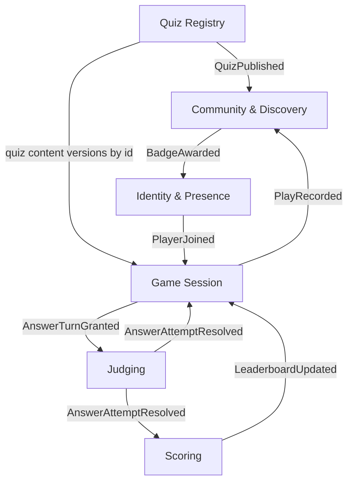

# Subdomains

One folder per subdomain's bounded context. Each has a `README.md` (context overview and key
events), `models/` (one file per model element: aggregates, entities, value objects, policies,
domain services), and `features/<name>/` (spec / usecase / sequence docs, as needed). Treat every
aggregate boundary as a hypothesis to be validated when we detail it, especially invariants, which
are the real test of whether a boundary is right.

## Overview

| Subdomain | Type | Bounded context | Folder |
|---|---|---|---|
| Gameplay | Core | Game Session | [`game-session/`](game-session/) |
| Answer judging | Core | Judging | [`judging/`](judging/) |
| Content community | Core | Community & Discovery | [`community/`](community/) |
| Quiz content | Supporting | Quiz Registry | [`quiz-registry/`](quiz-registry/) |
| Scoring | Supporting | Scoring | [`scoring/`](scoring/) |
| Moderation | Supporting (deferred) | inside Community for now | - |
| Identity & presence | Generic | Identity | [`identity/`](identity/) |

Core = where the product wins or loses: the feel of live buzzing, the progressive-choice judging
mechanic, and the content flywheel (good sets attract players → plays feed rankings → rankings and
badges reward creators → creators make more sets).

## Contexts and event flows

## Cross-context contracts (the arrows)

- Registry → Community: `QuizPublished` (immutable content version)
- Registry → Game Session: a quiz list resolved to quiz content versions at game start
- Identity → Game Session: `PlayerJoined`
- Game Session → Judging: `AnswerTurnGranted`
- Judging → Game Session, Scoring: `AnswerAttemptResolved`
- Game Session → Community: `PlayRecorded` / `GameCompleted`
- Scoring → Game Session (and clients): `LeaderboardUpdated`
- Community → Identity: `BadgeAwarded`

## Notes

- **"Question" means three things**: a `Quiz` with its content versions in the Registry, a read-only
  presented snapshot in Game Session, an answer key + format config in Judging. Do not share one
  type across contexts. The language split is evidence the boundaries are right.
- **Immutable versions are the currency.** Publishing a quiz creates an immutable `QuizContent`
  version, and changing a list's quizzes creates an immutable `QuizListEntries` version. Sessions
  bind to them at start, and rankings bind to them. Editing mid-game or post-ranking cannot mutate
  anything downstream.
- **Judging's integration surface is four messages**: `AnswerTurnGranted` (with deadline),
  `AnswerAttemptResolved`, `TurnRevoked`, and internally-guaranteed timeout resolution. Everything
  else is policy-internal.
- Bounded contexts are **not** deployment units. See ADR 0007.

## Open questions and parked hotspots

1. **Ranking integrity**: likes and plays are both farmable (self-plays, bot lobbies). Qualification
   rules (distinct players, minimum lobby size, decay) are domain logic in `RankingPolicy`. v1 may
   be like-count based. Revisit before rankings confer visible status.
2. **Version ranking semantics**: when a creator edits a ranked quiz or list, does reputation
   transfer to the new version? Rankings bind to immutable content and entries versions, and the
   transfer rule is undecided.
3. **Moderation ripple**: `SetDelisted` effects on rankings and in-flight sessions.
4. **LLM judge failure**: judge timeout must map to a defined `AttemptOutcome`, never a hung turn.
   Deadline is carried on the turn grant.
5. **Penalty rules for wrong answers**: scoring policy detail, TBD.
6. **Gameplay/Judging separability**: boundary currently holds (see ADR 0004). Re-run the
   separability test if a rule ever makes the session care about partial attempt progress.
7. **Group scope**: are groups a sharing/ranking scope, a social space with their own games, or
   both? Decide the v1 slice before modeling further.
8. **Shipped default participation mode**: sequential hayaoshi vs concurrent burst as the out-of-box
   experience. Product decision. Both are implemented as policies either way.
9. **RevealScript for mixed-script Japanese**: per-character reveal is not trivial with kanji/kana
   mixing and furigana. Pacing rules TBD with real question data.
