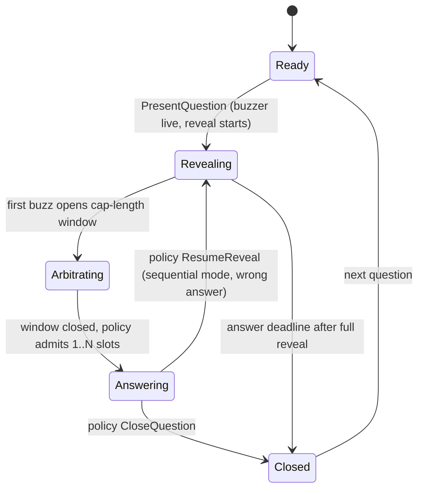

# GameSession

Aggregate root of a live session, the invariant keeper. Member entities: [`Round`](round.md),
[`PresentedQuestion`](presented-question.md), [`AnswerSlot`](answer-slot.md),
[`Participant`](participant.md).

## Session lifecycle

`Lobby → InProgress → Ended`, plus `Cancelled`. Trivial by design. The interesting machinery is the
question lifecycle.

## Question lifecycle (unified machine)

Questions are presented hayaoshi-style: the text reveals progressively, the buzzer is live from the
first character, and a buzz pauses the reveal.

Per-slot track, parallel to `Arbitrating`/`Answering`:
`Claimed → AttemptRunning → Resolved (correct | incorrect | timed out) | Forfeited`

## Invariants (aggregate-owned, transactional)

1. Buzz accepted only in buzz-accepting states, from an active participant holding no slot on this
   question. Mode-specific eligibility (lockouts) delegates to policy.
2. Slot ranks are contiguous 1..k and equal the arbitrated order.
3. At most one question is not `Closed` at any time.
4. An attempt resolution applies to exactly one claimed slot, exactly once.
5. Host-only commands are rejected from non-hosts.
6. RuleSet binds immutably at `GameStarted`.
7. Reveal timeline advances only via `RevealStarted` / `RevealPaused` / `RevealResumed`.

## ParticipationPolicy

The aggregate owns invariants. [`ParticipationPolicy`](participation-policy.md) chooses among
*legal* options at three decision points: slots admitted per arbitration window, buzz eligibility,
and resume-vs-close after attempts resolve. A policy bug can make a weird game, never a corrupt
session. The trait and the comparison of `SequentialHayaoshi` and `ConcurrentBurst` live in the
policy's file.

## Arbitration and the compensation cap

`compensated = arrival − min(rtt_estimate / 2, cap)`. The cap is simultaneously the fairness bound
**and the reordering window**: a slot cannot be finalized until `cap` ms after the first unfinalized
buzz, because a slower-network player's compensated-earlier buzz may still arrive. cap = 0 ⇒ raw
server-receive order and instant confirmation. Tournament caps trade tens of ms of confirmation
delay for fairness. Do not "optimize away" the delay.

`PlayerBuzzed` (raw arrival) and `AnswerSlotClaimed` (post-arbitration) are distinct events. Log per
buzz: raw arrival, RTT estimate, compensation applied, RevealMark. That is the audit trail for any
"the buzzer robbed me" dispute.

## Reveal timeline

The reveal is a schedule, not a stream: segments of (start time, rate), with pause/resume creating
new segments. Reveal position is a pure function of server time, so the compensated buzz timestamp
doubles as the player's `RevealMark` (how much text they had seen). Event-sourced as just
`RevealStarted` / `RevealPaused` / `RevealResumed`.

## Runtime shape

One actor per live session (task/goroutine owning the aggregate in memory, commands in via channel,
events out). All deadlines are timers inside the actor emitting events, so replays stay
deterministic. Persist by appending the event log asynchronously with periodic snapshots. The log
doubles as replay, spectator feed, and the `PlayRecorded` export.
